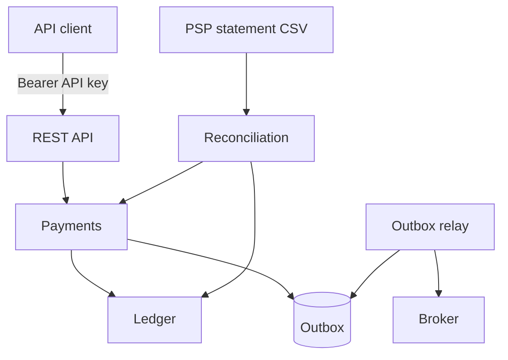

# payment-ledger-service

A small payments backend I built to work through the problems that show up once money is
involved: double-entry bookkeeping, retries that must not charge twice, events that must not get
lost, and checking our numbers against what the PSP says it settled.

It captures and refunds card payments, books every movement in a ledger, publishes events
through a transactional outbox and reconciles the PSP settlement file against both the payments
and the ledger.

Java 21, Spring Boot 3.5, PostgreSQL 17, Flyway and plain JDBC. No JPA on purpose: most of the
interesting parts here are locks and constraints, and I wanted the SQL in plain sight.



## Running it

You need Docker and JDK 21.

```bash
docker compose up -d

API_KEY=$(openssl rand -hex 32)
export SECURITY_CLIENTS_0_ID=checkout SECURITY_CLIENTS_0_ROLES=PAYMENTS,BACK_OFFICE
export SECURITY_CLIENTS_0_KEY_SHA256=$(printf %s "$API_KEY" | shasum -a 256 | cut -d' ' -f1)
DB_PASSWORD=payment_ledger ./scripts/mvn spring-boot:run
```

`scripts/mvn` is just Maven forced onto JDK 21, because my machine defaults to an older one.
The database settings come from `DB_URL`, `DB_USERNAME` and `DB_PASSWORD`; everything else
(fee, outbox retries, retention) is in `application.yml`.

Tests run with `./scripts/mvn verify`. Integration tests start PostgreSQL through
Testcontainers, so they hit a real database, triggers included.

## Using the API

Every request needs `Authorization: Bearer $API_KEY`; I've left it out below.

```bash
# capture R$ 159,90
curl -X POST localhost:8080/payments \
  -H 'Idempotency-Key: order-1001' -H 'Content-Type: application/json' \
  -d '{"merchantId":"merchant-42","amountMinor":15990,"currency":"BRL","pspReference":"ch_3Q8xYz"}'

# refund part of it
curl -X POST localhost:8080/payments/{id}/refunds \
  -H 'Idempotency-Key: order-1001-refund-1' -H 'Content-Type: application/json' \
  -d '{"amountMinor":5000,"pspReference":"re_1Pq7Ab"}'

curl localhost:8080/payments/{id}

# reconcile a day
curl -X POST 'localhost:8080/reconciliations?periodStart=2026-10-12&periodEnd=2026-10-13' \
  -F statement=@settlement.csv

# publish events again (dead ones, or a time window a consumer lost)
curl -X POST localhost:8080/outbox/replay -H 'Content-Type: application/json' \
  -d '{"from":"2026-10-12T00:00:00Z","to":"2026-10-13T00:00:00Z"}'
```

Amounts are always in cents. Errors come back as RFC 9457 problem details. The ones worth
knowing: 409 when a PSP reference was already used, and 422 when a refund goes over what's left
or an idempotency key is reused with a different body.

Health checks and Prometheus metrics are on a separate port (8081) without auth, so keep that
port internal.

## How it works

### The ledger

Each capture is a journal entry with three postings: we debit PSP clearing (the PSP owes us the
money), credit the merchant's payable for the amount minus our fee, and credit fee revenue.
A refund does the reverse, and the fee goes back to the merchant pro rata. After a full refund
every account is back to zero.

The rules that matter are enforced twice, once in the domain code and once by PostgreSQL:

- an entry has to balance. A deferred constraint trigger checks this at commit, so even a
  hand-written `INSERT` can't leave the books unbalanced;
- entries and postings are append-only, and triggers reject `UPDATE` and `DELETE`;
- one entry per operation and one operation per PSP reference, through unique constraints.

Accounts are locked with `SELECT ... FOR UPDATE` in id order, so two transactions touching the
same accounts can't deadlock. That creates a different problem, though: every capture touches the
same clearing and fee accounts, and captures end up queueing on those rows. So those accounts,
and each merchant's payable, are split into 16 shards (`PSP_CLEARING#7`) picked from the payment
id. The real balance is the sum of the shards. If you change the shard count later the totals
stay right, but a single shard can go negative, which is fine because nobody reads a shard on its
own.

### Not charging twice

Clients send an `Idempotency-Key`, the same idea as Stripe's. Usually that's a UUID created once
per checkout attempt, or something like the order id. The service stores the key, a hash of the
request and the response it sent back. If the request comes again, the client gets the stored
response with `Idempotent-Replayed: true` instead of a second charge.

The key is inserted in the same transaction as the payment. That way there's no state where
the payment exists but the key doesn't (or the other way around), and a failed attempt can simply
be retried with the same key. A second request racing the first one waits on that row and gets
the first one's answer. Keys belong to the API client, so two clients can't collide, and they're
deleted after 7 days. After that the unique PSP reference still blocks the duplicate with a 409.

### Events

`PaymentCaptured` and `PaymentRefunded` are written to an outbox table inside the payment's
transaction, so an event exists only if the payment does. A relay publishes them afterwards.

The relay claims a batch with `FOR UPDATE SKIP LOCKED` and gives it a lease instead of holding a
transaction while it talks to the broker. Several instances can run it at the same time. If one
dies, its events are picked up again when the lease expires, and it can't overwrite the result of
whoever took over. Failed publishes back off exponentially (1s up to 5 min). After 10 attempts an
event is marked `DEAD`, which is what you'd alert on, and it can be replayed by id once the cause
is fixed.

Delivery is at least once, so consumers have to dedupe on the event id. For now the broker is a
logging stub behind an `EventPublisher` interface; a Kafka or SNS adapter would slot in there.

### Reconciliation

The PSP sends a daily settlement file:

```
psp_reference,type,amount_minor,currency,settled_on
ch_3Q8xYz,CAPTURE,15990,BRL,2026-10-12
re_1Pq7Ab,REFUND,5000,BRL,2026-10-12
```

Each line is compared with the payment or refund and with what the ledger actually moved
through PSP clearing. Checking only the payments table isn't enough: a bug in the bookkeeping
would go unnoticed. The result lists what matched and every discrepancy: missing on our side,
missing in the file, different amount or currency, a ledger that disagrees, or a line that
appears twice. One malformed line rejects the whole file, since a half-imported statement would
show up as a pile of fake "missing" items.

### Code layout

There's one package per context (`ledger`, `payment`, `outbox`, `reconciliation`, `idempotency`,
`security`), each split into `domain`, `application`, `infrastructure` and `web`. The domain has
no Spring or JDBC imports, and `ArchitectureTest` (ArchUnit) fails the build if that or the
dependency direction changes.

## Tests

The tests I care most about:

- property-based tests (jqwik): random entries must keep the trial balance at zero, and random
  sequences of small refunds must never return more fee than was kept, with a full refund
  returning exactly the fee despite rounding;
- concurrency tests on a real PostgreSQL: parallel refunds of the same payment, the same
  idempotency key sent at the same time, two relays competing for the same events, and captures
  that must not block each other on the sharded accounts;
- database tests that skip the application and try to break the ledger directly with SQL;
- an end-to-end flow over HTTP: capture, refund, relay and reconciliation.

## What's missing

This is a study project, not something running in production. There's no real PSP or broker
integration, no currency conversion, no merchant payouts or chargebacks, and no list or search
endpoints. Rate limiting is left to whatever gateway sits in front of it.
